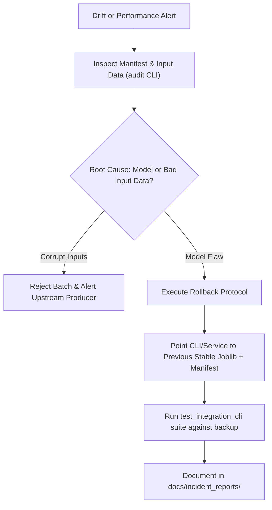

# Operations, Monitoring, and Controlled Retraining Runbook

## 1. Overview and Operational Scope

This document defines the operational governance, data drift monitoring, automated retraining criteria, and rollback procedures for the Ames Housing Price Prediction model.

- **Current Release:** v0.2.0 (`gradient_boosting` pipeline)
- **Primary Metrics:** Mean Absolute Error (MAE), RMSE, $R^2$, Median Absolute Error (MedAE).
- **Target Audience:** Batch prediction workflows and regression demonstration.

---

## 2. In-Service Monitoring & Drift Detection

### 2.1 Ingestion & Schema Failure Monitoring
Batch prediction requests must pass through runtime schema validation (`validate_prediction_data`). The following anomalies are logged and alertable:
- **Missing Required Predictor Columns:** Rejection with immediate actionable logging.
- **Target Leakage Detection:** Explicit detection and rejection of `SalePrice` in inference requests.
- **Non-Finite / Null Values:** Logging specific offending row indices and failing the batch to prevent garbage predictions.

### 2.2 Feature Distribution & Missingness Drift
Monitor incoming scoring batches against baseline training statistics:

| Feature | In-Bounds Range | Baseline Mean / Median | Anomaly / Drift Threshold |
|---|---|---|---|
| `TotalSF` | $334 - 4,500$ sq ft | Median: $2,464$ sq ft | $> 20\%$ of records $> 4,000$ sq ft or $< 500$ sq ft |
| `OverallQual` | $1 - 10$ integer | Mean: $6.10$ | Batch mean shift $> \pm 1.0$ point |
| `YearBuilt` | $1872 - 2010$ | Median: $1973$ | Presence of future dates or $> 50\%$ pre-1940 |
| `GarageCars` | $0 - 4$ | Median: $2.0$ | $> 10\%$ records $> 4$ cars |

If population shift exceeds the thresholds (e.g., Kolmogorov-Smirnov test $p < 0.05$ or Population Stability Index $\text{PSI} > 0.25$), an alert is triggered to review feature calibration.

### 2.3 Realized Performance Monitoring
When actual property sale prices eventually become available (e.g., deed records closing months post-prediction):
- Compute realized MAE and MedAE.
- **Degradation Trigger:** If realized batch MAE degrades by more than **$15\%$** relative to baseline holdout MAE ($> \$23,500$), trigger model review.

---

## 3. Retraining Policy & Governance

### 3.1 Triggers for Retraining
Retraining is **not** automated on a simple schedule. A scheduled job alone must never overwrite production weights. Retraining is triggered only by:
1. **New Ground-Truth Data Arrival:** Ingestion of a verified, vetted batch of recent property transactions.
2. **Concept / Market Drift:** Significant shifts in macro interest rates, inflation, or zoning alterations causing sustained degradation in realized MAE.
3. **Model Evolution:** Introduction of new verified features or superior regularized algorithms.

### 3.2 Candidate Acceptance Gate
A retrained candidate model must pass the following release gate before promotion:
1. **No Data Leakage:** Preprocessing transformations must be fitted strictly inside cross-validation folds.
2. **Benchmark Superiority:** Candidate must beat `DummyRegressor` ($MAE \approx \$56k$) and baseline `LinearRegression` ($MAE \approx \$24.8k$).
3. **Primary Holdout Ceiling:** Reserved holdout MAE must not exceed **$21,500.00**.
4. **Out-of-Time Stability:** Temporal holdout evaluation (`YrSold >= 2010`) must maintain $R^2 \ge 0.85$.
5. **Clean Verification:** All automated tests (`pytest`) pass and `ruff` reports 0 lint errors across all supported platforms.

### 3.3 Lineage & Manifest Record
Every retrained candidate must produce an immutable artifact pair:
- `artifacts/model_pipeline_<timestamp>.joblib`
- `artifacts/manifest_<timestamp>.json` (tracking dataset SHA-256, Git SHA, author, and evaluation metrics).

---

## 4. Rollback and Incident Response Protocol

If an incident occurs in production (e.g., catastrophic prediction errors on a specific property tier or latency spikes):



### Rollback Execution Steps:
1. Identify the previous verified model artifact and manifest (e.g., `artifacts/model_pipeline.joblib.bak` or tagged Git release).
2. Point the active configuration to the known good artifact path.
3. Run verification check:
   ```powershell
   ames-housing inspect-manifest --manifest artifacts/manifest.json
   ames-housing evaluate --data train.csv
   ```
4. Confirm prediction outputs return to nominal bounds before resuming automated batch scoring.
